# Advanced Python Engineering from Scratch

A senior-engineer-style course in writing clean, scalable, production-quality
Python. Every chapter is runnable, self-contained, pure standard library
(no pip installs required except optional linters noted in Chapter 11).

## Setup

```bash
python3 --version   # 3.10+ recommended (3.12 used to build this course)
cd chapterN_*/ && python3 <file>.py
```

## Map

| Chapter | Topic |
|---|---|
| 1 | OOP Deep Dive (classes, encapsulation, ABCs, protocols, dataclasses, DI) — builds a Task Management System |
| 2 | Decorators, from closures to `@retry`/`@cache` |
| 3 | Iterators — the protocol behind `for` |
| 4 | Generators — `yield`, lazy pipelines, memory |
| 5 | Exception Handling as an engineering discipline |
| 6 | Asyncio — coroutines, event loop, concurrent I/O |
| 7 | Multithreading — GIL, locks, ThreadPoolExecutor |
| 8 | Multiprocessing — true CPU parallelism |
| 9 | Concurrency Decision Framework |
| 10 | Production Logging |
| 11 | Modern Type Hinting |
| 12 | SOLID Principles (bad code → refactor) |
| 13 | Design Patterns in Python |
| 14 | Context Managers |
| 15 | Four capstone applications combining everything |

## Progression

```mermaid
flowchart LR
    F["Fundamentals\n(assumed)"] --> C1["Ch1 OOP"]
    C1 --> C2["Ch2 Decorators"]
    C2 --> C3["Ch3 Iterators"]
    C3 --> C4["Ch4 Generators"]
    C4 --> C5["Ch5 Exceptions"]
    C5 --> C6["Ch6 Asyncio"]
    C6 --> C7["Ch7 Threads"]
    C7 --> C8["Ch8 Processes"]
    C8 --> C9["Ch9 Concurrency Choice"]
    C9 --> C10["Ch10 Logging"]
    C10 --> C11["Ch11 Typing"]
    C11 --> C12["Ch12 SOLID"]
    C12 --> C13["Ch13 Patterns"]
    C13 --> C14["Ch14 Context Mgrs"]
    C14 --> C15["Ch15 Real Apps"]
```



Read each chapter's `README.md` first (concept, mental model, diagram,
internals, mistakes, production relevance), then run its `.py` file(s).
