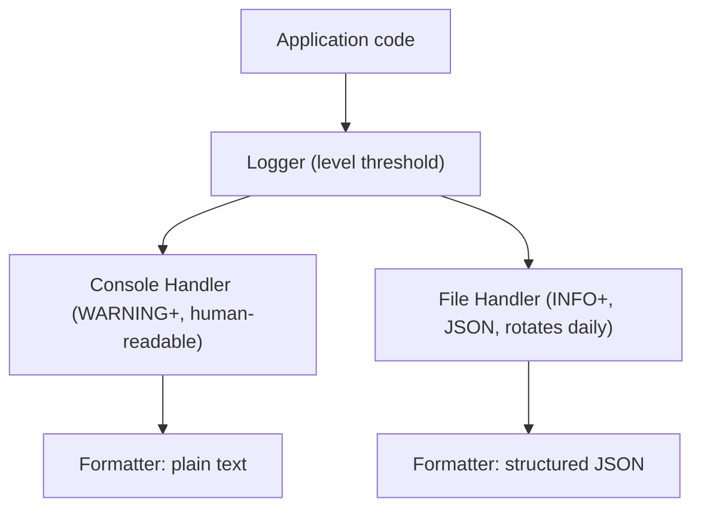

# Chapter 10 — Production-Grade Logging

## Concept

`print()` writes to stdout, unconditionally, with no metadata, no way to
filter by severity, and no way to route it elsewhere. **Logging** is a
configurable system: you emit messages tagged with a **severity level**,
and separately configure WHERE they go and HOW they're formatted —
without changing the code that emits them.

```
Application code: logger.info("Order placed", extra={"order_id": 123})
      |
      v
Logger (decides: is INFO enabled? which handlers get this?)
      |
      +--> Console Handler (formatted for humans, maybe only WARNING+)
      +--> File Handler (formatted as JSON, everything INFO+, rotates daily)
```

## Key pieces

- **Logger** — the object your code calls (`logging.getLogger(__name__)`).
  Has a level threshold; messages below it are dropped immediately.
- **Handler** — decides WHERE a log record goes (console, file, network).
  A logger can have multiple handlers, each with its own level threshold.
- **Formatter** — decides the exact text/structure of the output
  (timestamp format, plain text vs JSON, which fields appear).
- **Log levels** (ascending severity): `DEBUG < INFO < WARNING < ERROR <
  CRITICAL`. Setting a logger to `WARNING` silently drops `DEBUG`/`INFO`
  calls — they cost almost nothing when disabled.
- **Rotating logs** — cap file size/age so logs don't grow forever and
  fill the disk; old files are archived or deleted automatically.
- **Structured logging** — emit logs as JSON (or another structured
  format) instead of free text, so log aggregation tools (ELK, Datadog,
  CloudWatch) can filter/query by field instead of regexing text.
- **Contextual information** — attach request IDs, user IDs, or other
  per-operation context so you can trace one request's full story across
  many log lines (`extra={...}` or a `LoggerAdapter`).
- **Correlation IDs** — a single ID generated at the start of a request/
  operation, threaded through every log line touching it, so scattered
  log lines can be reassembled into one causal story.
- **Exception logging** — `logger.exception(...)` (or `exc_info=True`)
  captures the full traceback automatically, not just your message.

## Why print() doesn't scale

`print()` has no levels (can't turn off noisy output without editing
code), no routing (can't send errors to one place and info to another),
no structure (can't be queried), and no context (no request ID
threading). Every real service replaces it with logging almost
immediately.

## Diagram



## Files

`logging_setup.py` — a full setup: console + rotating file handlers with
different levels/formatters, structured (JSON) logging, contextual
fields via `extra`, a correlation-ID pattern using a custom
`LoggerAdapter`, and proper exception logging.

## Run it

```bash
python3 logging_setup.py
```
Check the generated `app.log` file afterward to see the structured JSON
output alongside the human-readable console output.

## Experiment

1. Change the console handler's level to `ERROR` and rerun — notice INFO/
   WARNING lines disappear from the console but STILL appear in
   `app.log`, because each handler has its own independent threshold.
2. Trigger the rotation by lowering `maxBytes` drastically and generating
   many log lines in a loop — watch `app.log.1`, `app.log.2` etc. appear.
3. Remove the correlation ID from one log call in the middle of a
   simulated request and notice how much harder it becomes to tell which
   request a stray log line belongs to once you have concurrent requests
   in a real system — this is the actual production motivation for
   correlation IDs, not a hypothetical one.
