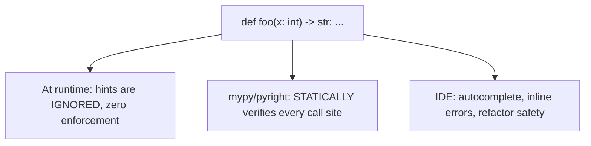

# Chapter 11 — Modern Type Hinting

## Concept

Python is dynamically typed at runtime — type hints add NO runtime
enforcement by themselves (Python will happily run `def add(a: int, b:
int) -> int: return a + b` with strings, hints or no hints). Their value
is entirely at **development time**: IDEs and static type checkers
(`mypy`, `pyright`) use them to catch bugs, power autocomplete, and make
refactoring safer, before the code ever runs.

## Why type hints matter in large codebases

- **IDE support** — real autocomplete, "go to definition", and inline
  errors instead of guessing what a function expects.
- **Readability** — `def process(data: dict[str, list[int]]) -> bool:`
  tells you the shape of the data without reading the function body.
- **Refactoring safety** — rename a field, run the type checker, and it
  tells you every call site that's now wrong — instead of finding out at
  3am in production.
- **Bug detection** — a type checker catches "you passed a `str` where an
  `int` was expected" before you ever run the code.
- **API contracts** — a function signature with hints IS documentation
  that can't silently drift out of sync with the code (a comment can lie;
  a hint the type checker enforces cannot, easily).

## Coverage in this chapter

- Basic hints: `int`, `str`, `list[int]`, `dict[str, int]`, `tuple[int, ...]`
- `Optional[X]` (shorthand for `Union[X, None]`) and `Union[X, Y]`
  (modern syntax: `X | None`, `X | Y`)
- `Any` — opts OUT of type checking for that spot; use sparingly, it's an
  escape hatch, not a solution.
- `Callable[[ArgTypes], ReturnType]` — typing a function-as-a-value.
- `TypeAlias` — name a complex type once, reuse the name.
- `Generic` / `TypeVar` — write one class/function that works with many
  types while preserving the specific type through the signature (e.g. a
  `Stack[T]` that pops the same type `T` you pushed).
- `Protocol` — structural typing (recap from Chapter 1) formalized for
  the type checker.
- `TypedDict` — a `dict` with a fixed, known set of keys and per-key
  types (great for JSON-shaped data without a full class).
- `Literal` — restrict a value to specific literal options (`Literal["asc", "desc"]`).
- `Final` — a value/attribute that must not be reassigned (checker-enforced).
- `@overload` — declare multiple valid signatures for one function whose
  behavior genuinely varies by argument type.

## Mental model

Type hints are a contract you write for two audiences: the type checker
(which verifies the contract is upheld everywhere) and the next engineer
reading your code (who trusts the contract instead of reading the whole
function body to infer what's expected).

## Diagram



## Using mypy / pyright

```bash
pip install mypy
mypy typing_examples.py
```
Try introducing a deliberate type error (e.g. call a hinted `int`
function with a string) and run `mypy` again — it catches it without
running the code at all.

## Files

`typing_examples.py` — every construct above, each in an isolated,
runnable, demonstrable section.

## Run it

```bash
python3 typing_examples.py     # runs fine -- hints don't affect runtime
mypy typing_examples.py        # THIS is where type errors get caught (if installed)
```

## Experiment

1. Add a line that violates one of the type hints (e.g. pass a `str`
   where `Stack[int]` expects an `int`) and confirm: it still RUNS fine
   with plain `python3`, but `mypy` flags it. This is the core lesson of
   the whole chapter, made concrete.
2. Replace one `Union[X, None]` with the modern `X | None` syntax
   (Python 3.10+) and confirm both mean the same thing to the checker.
3. Write a `TypedDict` for a JSON API response you actually work with
   (e.g. a UKG DocGen payload shape) and see how much clearer the
   function signature becomes versus a bare `dict`.
