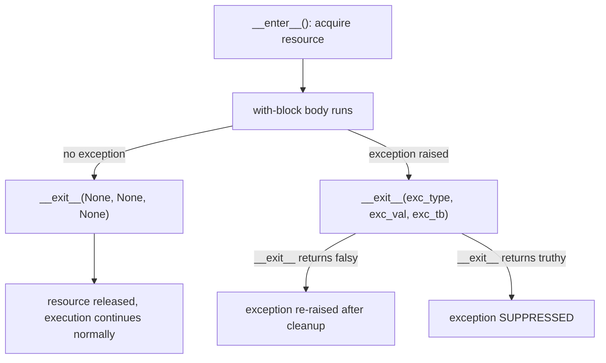

# Chapter 14 — Context Managers

## Concept

```python
with resource() as r:
    body(r)
```
is conceptually:
```python
r = resource().__enter__()
try:
    body(r)
finally:
    resource_instance.__exit__(exc_type, exc_val, exc_tb)
```
`__enter__` sets up (and returns whatever `as r` should bind to).
`__exit__` ALWAYS runs on the way out — exception or not — which is what
makes `with` the correct tool for guaranteed cleanup (closing files,
releasing locks, rolling back transactions), stronger than a plain
`finally` block because it also bundles the setup logic in one place.

## Mental model

A context manager is a well-trained doorman: they open the door for you
(`__enter__`), and no matter how you leave the building — walked out
calmly, or sprinted out because something caught fire (an exception) —
they close the door behind you (`__exit__`). You never have to remember
to close it yourself.

## `__exit__`'s return value matters

If `__exit__` returns a truthy value, it SUPPRESSES the exception that
was propagating — the `with` block acts as if nothing went wrong. If it
returns `None`/falsy (the default), the exception propagates normally
after cleanup runs. This is a real, easy-to-miss detail with functional
consequences.

## Diagram



## contextlib

`contextlib.contextmanager` turns a generator function into a context
manager without writing a class: everything before `yield` is
`__enter__`, everything after is `__exit__` (and it runs in a `finally`
automatically if you wrap the yield in try/finally yourself).

## Files

`context_managers.py` — a hand-written class-based context manager, the
`contextlib.contextmanager` generator-based equivalent, and four real
use cases: a mock database connection, file handling (using the real
built-in), a lock, and a mock transaction with commit/rollback.

## Run it

```bash
python3 context_managers.py
```

## Experiment

1. Make `__exit__` in the mock database example return `True` when it
   catches a specific exception type, and confirm the exception is
   swallowed instead of propagating — then reason about when that's
   actually the RIGHT behavior (rare) vs a bug that hides real failures
   (common — be careful with this).
2. Remove the `try/finally` from the `contextlib.contextmanager`-based
   lock example and force an exception inside the `with` block — observe
   the lock never gets released, a real, common bug in generator-based
   context managers when the cleanup isn't wrapped in `finally`.
3. Nest two context managers (e.g. a transaction inside a lock) using
   `with a, b:` and trace through the order `__enter__`/`__exit__` fire
   in — notice `__exit__` order is the REVERSE of `__enter__` order,
   same as nested `finally` blocks would be.
