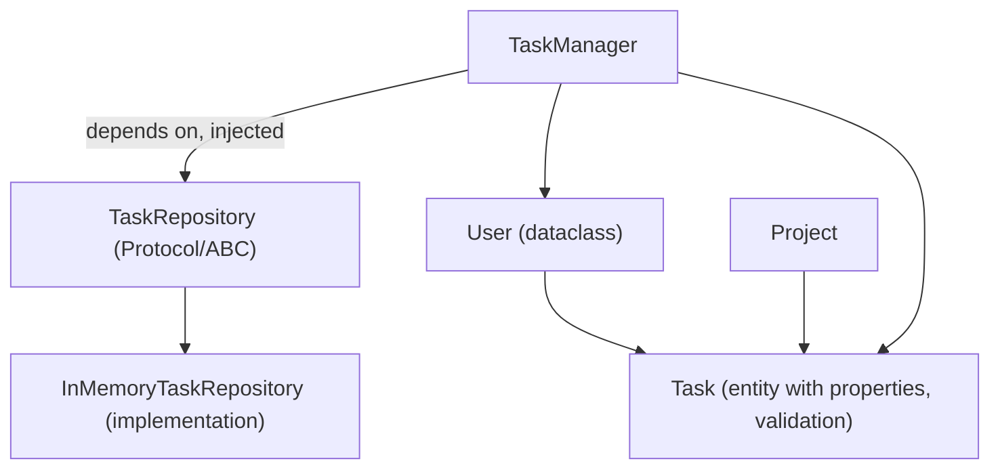

# Chapter 1 — OOP Deep Dive

## Concept

Python OOP beyond basic classes. The through-line for every concept below:

```
Example -> Object -> State -> Behavior
```

An object bundles state (attributes) and behavior (methods). Every OOP
tool in this chapter is a different way of controlling how state and
behavior are organized, shared, hidden, or swapped out.

## Concepts covered (with when-to-use / when-not-to-use)

- **Instance vs class attributes** — instance = per-object; class =
  shared. Use class attributes for constants/shared registries; NEVER
  for mutable per-object state (classic bug: a shared mutable list).
- **Instance / class / static methods** — `self` (this object), `cls`
  (the class, for alt-constructors), no-arg (pure helper). Use
  `@classmethod` for `from_x()` constructors; `@staticmethod` only for
  logic touching neither instance nor class state.
- **Encapsulation** — Python has no true private attributes. `_x` is a
  convention (do this almost always); `__x` triggers name mangling
  (rare, mainly to avoid subclass collisions). Real protection comes
  from `@property`, not naming.
- **Abstraction** — hide implementation, expose intent, via ABCs or
  Protocols (below).
- **Inheritance** — "is-a" relationship, shared implementation. Overused
  in naive OOP; prefer composition unless the "is-a" is genuinely stable.
- **Polymorphism** — same interface, different implementation. In Python
  this is mostly duck typing, not inheritance-required.
- **Composition** — "has-a", object holds another object and delegates.
  Prefer this over inheritance by default — it's more flexible and
  doesn't create fragile deep hierarchies.
- **Aggregation** — a looser "has-a" where the contained object can
  outlive the container (e.g. a `TaskManager` references `User`s that
  exist independently).
- **Abstract Base Classes (ABCs)** — enforce "subclasses MUST implement
  this method," checked at instantiation time. Use when you own the
  hierarchy and want to guarantee a contract.
- **Protocols** (`typing.Protocol`) — structural typing: "anything with
  this shape counts," no inheritance required. Use for external/third-
  party types you don't control, or to avoid forcing inheritance.
- **Dataclasses** — auto-generate `__init__`, `__repr__`, `__eq__` for
  data-holding classes. Use for anything that's mostly data; skip for
  classes with heavy custom behavior where the boilerplate isn't the pain.
- **Properties** — turn attribute access into method calls transparently,
  enabling validation without breaking the calling code's syntax.
- **Magic/dunder methods** — hook into Python's own protocols (`__eq__`,
  `__repr__`, `__len__`, `__iter__`, etc.) so your objects behave like
  built-ins where it makes sense.
- **Dependency Injection** — pass in collaborators (e.g. a repository)
  rather than constructing them inside the class. Makes testing and
  swapping implementations trivial; the "when NOT to" is: for truly
  fixed, stateless helpers, DI is often overkill.

## Mental model

Every concept here answers one question: **who owns this state, and who
is allowed to change it, how?** Class vs instance attributes: who owns
it. Encapsulation/properties: who's allowed to change it, and under what
rules. Inheritance/composition/protocols: how behavior is shared or
swapped without duplicating code.

## Architecture — the app this chapter builds



`TaskManager` never constructs its own repository — one is *injected* —
which is Dependency Injection in action, and is what makes
`task_management_app.py`'s test-style demo able to swap in a fake
repository with zero changes to `TaskManager` itself.

## Files

- `oop_concepts.py` — small, isolated demonstrations of every bullet
  above, runnable independently, each printing its own output.
- `task_management_app.py` — the concepts combined into one small,
  progressively-composed application.

## Run it

```bash
python3 oop_concepts.py
python3 task_management_app.py
```

## Experiment

1. In `oop_concepts.py`, break the mutable-class-attribute example on
   purpose, observe the leak, then fix it.
2. In `task_management_app.py`, write a second repository
   implementation (e.g. `JsonFileTaskRepository` writing to a `.json`
   file) and swap it into `TaskManager` — change zero lines in
   `TaskManager` itself. That swappability is the entire point of DI +
   Protocol/ABC.
3. Try making `Task.title` empty via direct attribute assignment vs via
   the constructor — notice the `@property` setter catches both paths,
   because it governs ALL assignment to `.title`, not just `__init__`.
