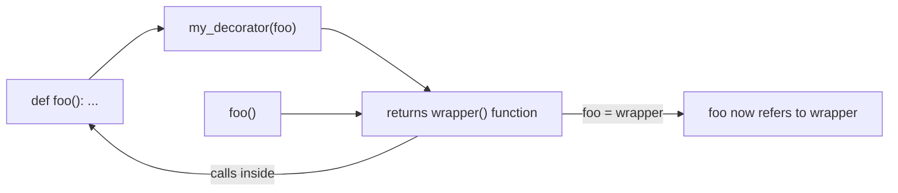

# Chapter 2 — Decorators

## Concept, built from first principles

```
Functions are objects
      -> can be passed around like any value
      -> can be returned from other functions
      -> closures: an inner function remembers variables from its enclosing scope
      -> a decorator is just: a function that takes a function, returns a
         new function that wraps it
```

When Python sees:
```python
@my_decorator
def foo(): ...
```
it is EXACTLY equivalent to:
```python
def foo(): ...
foo = my_decorator(foo)
```
No magic. `@decorator` is syntax sugar for reassigning the name to
whatever the decorator function returns.

## Mental model

A decorator is a gift-wrapper for a function. The original function is
still inside, unchanged. The wrapper adds behavior before/after calling
it (logging, timing, retrying) without the caller needing to know.

## Diagram



## Files

- `decorators_from_scratch.py` — closures, a manual decorator built step
  by step, `functools.wraps`, decorators with arguments, class
  decorators.
- `practical_decorators.py` — `@timer`, `@logger`, `@retry`, `@validate`,
  `@cache`, built from scratch (not `functools.lru_cache`, so you see the
  mechanism) plus a note on where these patterns show up in real
  frameworks.

## Where decorators appear in real frameworks

- **Flask**: `@app.route("/users")` — registers a function as a URL
  handler. The decorator doesn't change what the function does; it
  registers it in a routing table as a side effect.
- **FastAPI**: `@app.get("/users/{id}")` — same idea, plus FastAPI reads
  type hints (Chapter 11) on the decorated function to build request
  validation and docs automatically.
- **Django**: `@login_required` — wraps a view function so unauthenticated
  requests are redirected before the original view ever runs.
- **pytest**: `@pytest.fixture`, `@pytest.mark.parametrize` — decorators
  that mark or inject behavior into test functions without changing how
  you write the test body.

## Run it

```bash
python3 decorators_from_scratch.py
python3 practical_decorators.py
```

## Experiment

1. In `decorators_from_scratch.py`, remove `@functools.wraps(func)` from
   the manual decorator and print `wrapped_function.__name__` — watch it
   become `"wrapper"` instead of the real function's name. This is a
   real, common debugging headache (stack traces and introspection tools
   show the wrong name) that `wraps` silently fixes.
2. In `practical_decorators.py`, stack two decorators on the same
   function (`@timer` then `@retry`) and reason through the expansion
   order yourself before checking the printed call order.
3. Modify `@retry` to take a `backoff_factor` argument and use
   exponential backoff between attempts.
