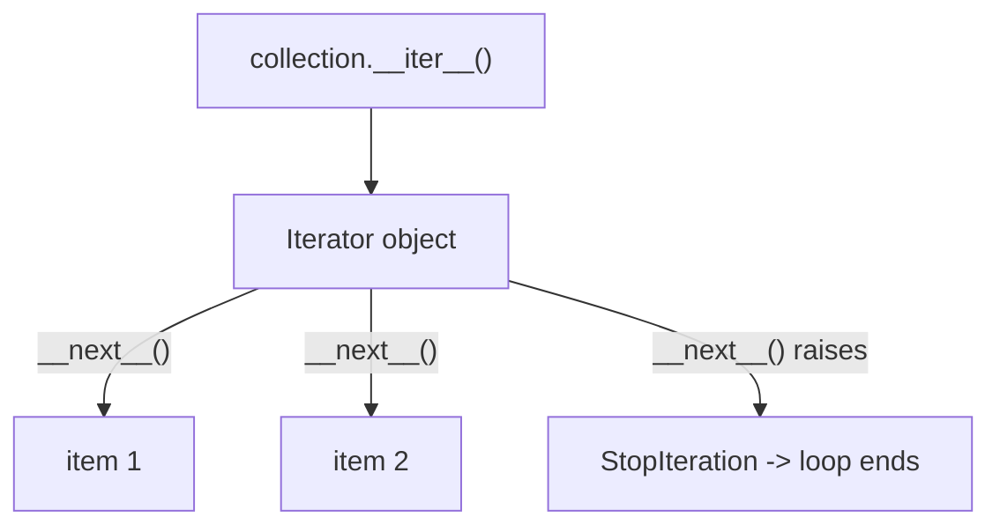

# Chapter 3 — Iterators

## Concept

```
Iterable -> has __iter__() -> returns an Iterator
Iterator -> has __next__() -> returns next item, or raises StopIteration
```

An **iterable** is anything you can call `iter()` on. An **iterator** is
the stateful object that actually produces values one at a time via
`__next__()`. Every iterator is also an iterable (its `__iter__` just
returns itself), but not every iterable is an iterator (a `list` is
iterable but is not itself an iterator — it produces a fresh iterator
each time).

## Mental model

An iterable is a book. An iterator is a bookmark plus a "turn the page"
action. Multiple readers (iterators) can go through the same book
(iterable) independently, each with their own bookmark and progress.

## What `for item in collection:` actually does

```python
for item in collection:
    body(item)
```
is conceptually:
```python
_it = iter(collection)      # calls collection.__iter__()
while True:
    try:
        item = next(_it)    # calls _it.__next__()
    except StopIteration:
        break
    body(item)
```
There is no special "for-loop" mechanism in the interpreter beyond this —
`for` is syntax sugar over exactly this protocol.

## Diagram



## Why iterators matter for large data / streaming

A `list` holds every element in memory at once. An iterator holds only
enough state to produce the *next* element — it never needs the whole
sequence in memory simultaneously. This is the foundation Chapter 4
(generators) builds on for genuinely large or infinite data.

## Files

`custom_iterators.py` — a custom iterator class, an infinite iterator,
and a stateful iterator (one that can be paused/resumed and reflects
external state changes).

## Run it

```bash
python3 custom_iterators.py
```

## Experiment

1. Try calling `next()` on an exhausted iterator a second time — confirm
   it keeps raising `StopIteration` rather than resetting.
2. Take the custom `Countdown` iterator and try iterating over the SAME
   instance twice with two separate `for` loops — notice the second loop
   gets nothing, because the iterator's internal state was already
   consumed. Then fix it by making the class iterable (returning a new
   iterator from `__iter__`) vs being the iterator itself.
3. Modify the infinite iterator to stop after producing a value greater
   than some threshold, using `break` in the consuming loop.
