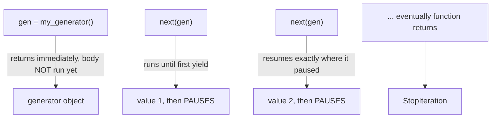

# Chapter 4 — Generators

## Concept

```
Iterator (Chapter 3, hand-written __iter__/__next__)
      -> Generator (same protocol, but Python writes the boilerplate for you)
      -> yield
```

A **generator function** is any function containing `yield`. Calling it
doesn't run the body — it returns a generator OBJECT immediately, which
is an iterator. Each call to `next()` on it runs the function body until
the next `yield`, then pauses, preserving all local state, until resumed.

## List vs Iterator vs Generator

| | Memory | When values are computed |
|---|---|---|
| List | Holds ALL elements at once | Eagerly, all up front |
| Iterator (Ch. 3) | Holds only current position/state | Lazily, one at a time |
| Generator | Same as Iterator, less boilerplate | Lazily, one at a time |

A generator IS a specific, convenient way to write an iterator — nothing
more. Everything Chapter 3 taught about the protocol still applies
underneath.

## Memory implications — the core reason this chapter exists

Given 10 million records:
- **Load everything into a list**: peak memory = size of all 10 million
  records, all at once, even if you only ever look at one at a time.
- **Process one item at a time via a generator**: peak memory = size of
  ONE record (plus whatever small state the generator holds). This is
  the difference between a script that works and one that gets OOM-killed
  on a large enough input.

## Diagram



## Files

- `generators_basics.py` — `yield`, `yield from`, generator expressions,
  lazy evaluation demonstrated with a side-effect print, `send()`,
  `close()`, `throw()`.
- `streaming_pipeline.py` — a concrete memory comparison (list vs
  generator) and a multi-stage streaming pipeline built from chained
  generators.

## Run it

```bash
python3 generators_basics.py
python3 streaming_pipeline.py
```

## Experiment

1. In `generators_basics.py`, add a `print()` inside the generator body
   before each `yield` and observe exactly when it fires relative to
   your `for` loop's own prints — this makes laziness visible, not just
   theoretical.
2. In `streaming_pipeline.py`, increase `RECORD_COUNT` by 100x and watch
   the list-based approach's memory/time grow linearly while the
   generator pipeline's peak memory stays flat.
3. Try calling `.send()` on a generator that hasn't been advanced to its
   first `yield` yet (i.e. before any `next()` call) — read the
   `TypeError` message it produces and understand why priming is required.
