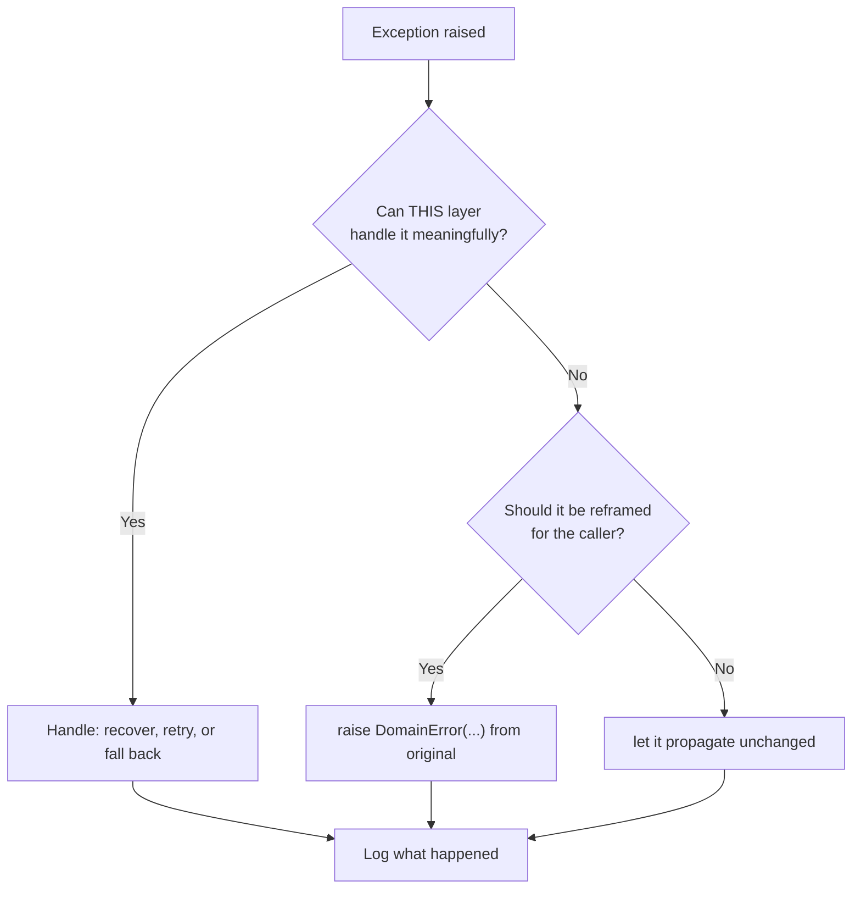

# Chapter 5 — Exception Handling as an Engineering Discipline

## Concept

Exception handling isn't "wrap things in try/except so it doesn't crash."
It's a deliberate design question at every raise site:

```
Exception occurs
      -> Where should it be handled?
      -> Handled / transformed / propagated
      -> Logging
      -> Recovery or failure
```

Key building blocks:
- `try` / `except` / `else` / `finally` — `else` runs only if no exception
  occurred (rarely used, but genuinely useful for "success-only" logic);
  `finally` always runs, exception or not (cleanup).
- **Custom exceptions** — define your own exception classes for your
  domain's failure modes, instead of raising/catching bare `Exception` or
  built-ins that don't convey intent.
- **Exception hierarchy** — design a base exception for your
  application/library, with specific subclasses, so callers can catch at
  whatever granularity they need.
- **Exception chaining** (`raise X from Y`) — preserve the original cause
  when you transform one exception into another, instead of losing the
  trail.
- **Retryable vs non-retryable errors** — a `ConnectionError` might be
  worth retrying; a `ValueError` from bad input almost never is. Your
  exception hierarchy should make this distinction inspectable by callers
  (e.g. a `RetryableError` base class), not just documented in a comment.
- **Defensive programming** — validate at boundaries (user input, API
  responses, config) so invalid states get caught early and loudly,
  rather than causing a confusing failure three layers deeper.

## Why `except Exception: pass` is bad

```python
try:
    do_something_risky()
except Exception:
    pass
```
This catches **everything**, including bugs you didn't anticipate
(`AttributeError` from a typo, `KeyboardInterrupt`'s cousins if you catch
`BaseException`), and discards all information about what went wrong. The
program continues in a state you don't understand, which is worse than
crashing — a crash is at least loud. This pattern is the single most
common way real production bugs go undiagnosed for months.

## Mental model

Think of exceptions as a support escalation path. A junior engineer
(inner function) hits a problem. They can: fix it themselves (handle
locally), escalate with more context ("this failed because X" — chaining),
or escalate as-is (propagate). What they must never do is quietly close
the ticket without telling anyone (`except: pass`).

## Diagram



## Files

`exception_handling.py` — custom exception hierarchy, chaining, a
retryable-vs-not distinction, a bad-vs-good comparison, and a small
robust error-handling strategy for a mock "order processing" operation.

## Run it

```bash
python3 exception_handling.py
```

## Experiment

1. Trigger the bad `except Exception: pass` example on purpose, then add
   a typo-bug (e.g. reference an undefined variable) inside the
   try-block and watch it get silently swallowed too — that's the real
   danger, not just "errors you expected" going unhandled.
2. Extend the exception hierarchy with a `PaymentDeclinedError(RetryableError)`
   subclass and route it through the retry-vs-fail logic.
3. Remove `from original_error` from one of the chained raises and
   compare the resulting traceback — notice you lose the "The above
   exception was the direct cause of..." context that makes debugging
   layered failures tractable.
