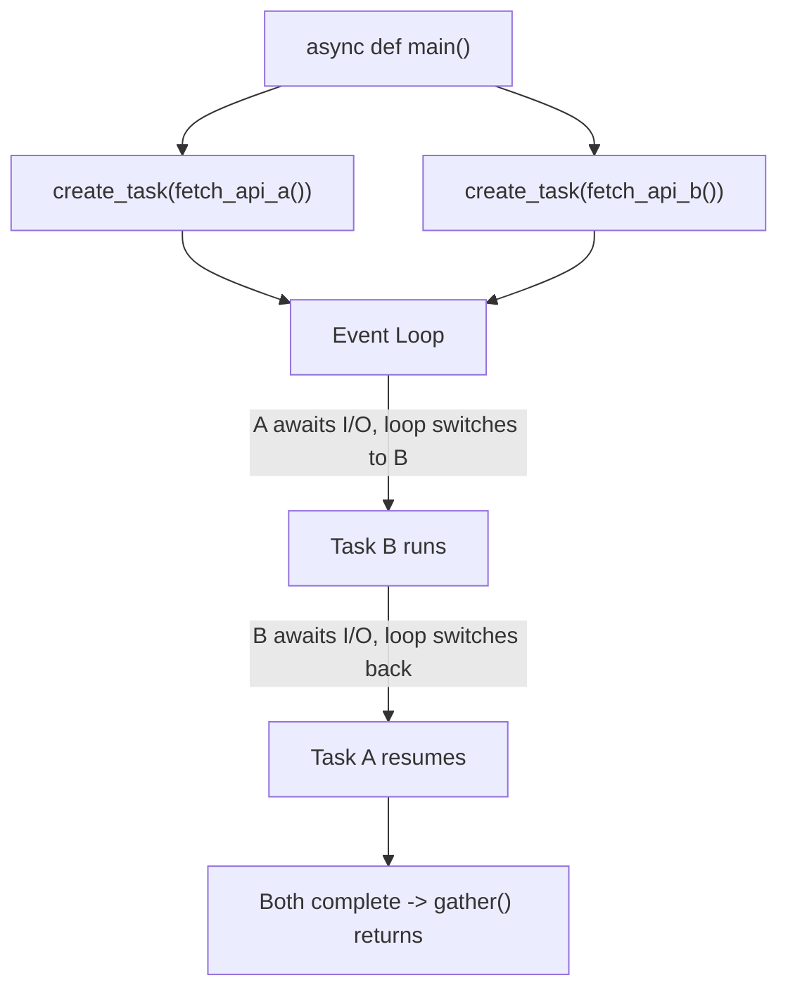

# Chapter 6 — Asyncio

## Concept: four things people conflate

- **Synchronous execution**: one thing at a time, strictly in order.
- **Concurrency**: multiple tasks make progress over overlapping time
  periods, by interleaving — not necessarily running at the exact same
  instant.
- **Parallelism**: multiple tasks run at the literal same instant (needs
  multiple CPU cores — Chapter 8, multiprocessing).
- **Asynchronous execution**: a specific style of concurrency where a
  single thread cooperatively switches between tasks whenever one is
  waiting on I/O (network, disk, timers), rather than using multiple
  OS threads.

```
Synchronous:
Task A ────────────>
Task B                ────────────>
(total time = A + B)

Async (single thread, cooperative):
Task A ──┐
         ├── both waiting on I/O, event loop switches between them
Task B ──┘──────────>
(total time ≈ max(A, B), not A + B)
```

Async gives you concurrency, not parallelism — it does NOT make CPU-bound
code faster (that needs Chapter 8). It shines specifically for I/O-bound
work: waiting on network calls, disk, or timers, where the CPU is idle
anyway during the wait.

## Mental model

Imagine a single chef (one thread) cooking multiple dishes. Instead of
standing and staring at water boil for dish A (blocking), the chef starts
dish A boiling, immediately starts prepping dish B while waiting, and
comes back to A the instant it's ready. One chef, no additional cooks
(threads), but far less idle waiting than doing dishes fully sequentially.

## Key terms

- **coroutine**: a function defined with `async def`. Calling it doesn't
  run it — it returns a coroutine OBJECT (similar to how a generator
  function returns a generator object) that must be awaited or scheduled.
- **await**: pause THIS coroutine until the awaited thing completes,
  yielding control back to the event loop so it can run something else
  in the meantime.
- **event loop**: the single-threaded scheduler that decides which
  ready-to-run coroutine gets the CPU next.
- **Task**: a coroutine wrapped and scheduled to run concurrently with
  others (`asyncio.create_task`).
- **Future**: a lower-level "eventual result" primitive Tasks are built
  on; you rarely construct these directly in application code.
- **asyncio.gather()**: run multiple awaitables concurrently, collect all
  results once every one of them finishes.

## Diagram



## Files

- `asyncio_basics.py` — coroutines, `await`, the event loop, tasks,
  `gather`, `create_task`, async context managers, async generators.
- `concurrent_api_fetch.py` — a mock "fetch from multiple APIs
  concurrently" application (uses `asyncio.sleep` to simulate network
  latency — no real network calls, fully self-contained and fast) with a
  timed side-by-side comparison against doing the same calls sequentially.

## Run it

```bash
python3 asyncio_basics.py
python3 concurrent_api_fetch.py
```

## Experiment

1. In `concurrent_api_fetch.py`, change one mock API's simulated latency
   to be much longer than the others and observe that `gather()`'s total
   time is bounded by the SLOWEST call, not the sum of all of them.
2. Replace `asyncio.gather()` with awaiting each coroutine one at a time
   in a loop (no `create_task`) and time it — confirm this degrades back
   to sequential-style timing, because nothing was scheduled to run
   concurrently.
3. In `asyncio_basics.py`, try calling a coroutine function WITHOUT
   `await` or `asyncio.run()` and read the `RuntimeWarning` Python gives
   you about "coroutine was never awaited" — this is one of the most
   common async bugs in real code.
