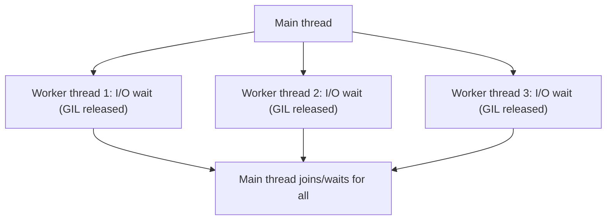

# Chapter 7 — Multithreading

## Concept

A **thread** is an independent sequence of execution within the SAME
process, sharing the same memory space as every other thread in that
process. The **main thread** is the one that starts running when your
program begins; you can spawn additional threads from it.

**The GIL (Global Interpreter Lock)**: CPython (the standard Python
implementation) has a single lock that allows only ONE thread to execute
Python bytecode at any given instant, even on a multi-core machine. This
means threads do NOT give you true parallelism for CPU-bound Python code
— they take turns, not run simultaneously, at the bytecode level.

So why do threads exist at all? Because the GIL is released during I/O
waits (network calls, file reads, `time.sleep`, and many C-extension
operations). So for I/O-bound work, threads genuinely help: while one
thread is blocked waiting on I/O, another can run.

## Thread vs Process vs AsyncIO

| | Parallelism? | Best for | Overhead |
|---|---|---|---|
| Threads | No (GIL) | I/O-bound, and existing blocking libraries | Moderate (OS threads) |
| AsyncIO | No (single thread) | I/O-bound, at high concurrency (1000s of tasks) | Very low |
| Processes (Ch. 8) | Yes (separate interpreters) | CPU-bound | High (separate memory, IPC) |

Threads and asyncio solve the SAME class of problem (I/O-bound
concurrency) via different mechanisms. Processes solve a different
problem entirely (CPU-bound parallelism).

## Mental model

Threads are like several cashiers sharing one cash register (the GIL):
only one can actually use the register at a time, so it doesn't speed up
counting money faster in total — but while one cashier is walking to the
back room to get change (I/O wait), another can step up and use the
register. No time is wasted on the walk.

## Diagram



## Key primitives

- **Lock** — mutual exclusion: only one thread at a time in a critical
  section. Prevents race conditions on shared state.
- **RLock** (reentrant lock) — like Lock, but the SAME thread can acquire
  it again without deadlocking itself (useful for recursive functions
  needing the lock).
- **Event** — a simple flag threads can wait on and one thread can set.
- **Semaphore** — like a Lock but allows up to N threads in simultaneously
  (e.g. limiting concurrent connections to 5).
- **Queue** — thread-safe FIFO, the standard way to hand work/results
  between threads without manual locking.
- **ThreadPoolExecutor** — manages a pool of worker threads for you; the
  idiomatic, modern way to use threads for most tasks.

## Files

`threading_basics.py` — thread creation/lifecycle, a Lock demonstrating
a real race condition and its fix, an Event, a Semaphore, a Queue-based
producer/consumer, and `ThreadPoolExecutor` on an I/O-bound workload with
a timed comparison against sequential execution.

## Run it

```bash
python3 threading_basics.py
```

## Experiment

1. Remove the `Lock` from the race-condition demo and run it several
   times — observe the final counter value is often WRONG and different
   each run, a real, reproducible demonstration of a race condition, not
   just a theoretical warning.
2. Change the `ThreadPoolExecutor`'s `max_workers` from a high number down
   to 1 and observe the timing degrade toward sequential — this shows the
   pool size directly controls achievable I/O concurrency.
3. Try replacing the I/O-bound demo's `time.sleep()` calls with a genuine
   CPU-bound loop (e.g. summing squares up to a large number) and compare
   the multi-threaded timing to a single-threaded version — notice
   threads provide little to no speedup here, because of the GIL. This
   sets up exactly why Chapter 8 (processes) exists.
