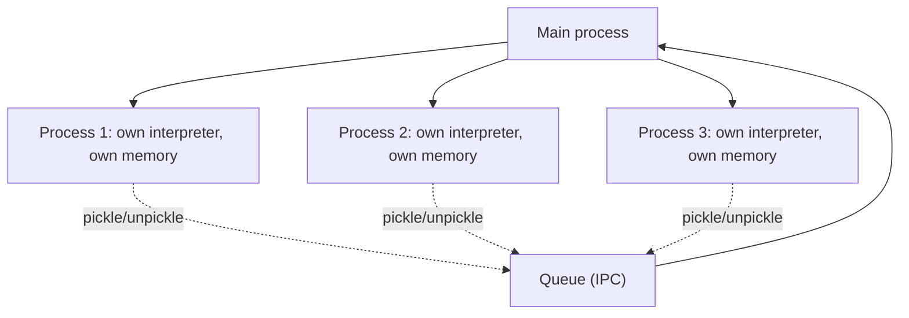

# Chapter 8 — Multiprocessing

## Concept

```
Process
   -> an independent Python interpreter, its own GIL
   -> separate memory space (no shared variables by default)
   -> true CPU parallelism (multiple cores actually run simultaneously)
```

Unlike threads, which share one process's memory and are limited by a
single GIL, each **process** is a fully separate Python interpreter with
its own GIL and its own memory. This means N processes can genuinely use
N CPU cores at the same time — real parallelism, not just concurrency.

The cost: processes can't share memory directly. Data passed between
them must be **serialized** (pickled), sent, and **deserialized**
(unpickled) on the other side — this has real overhead, so multiprocessing
is worth it for CPU-heavy work, not for passing huge amounts of data
back and forth for trivial computation.

## Key primitives

- **`multiprocessing.Process`** — the low-level building block: spawn one
  process running a target function.
- **`Pool`** — manages a fixed set of worker processes, distributes work
  across them (`map`, `apply`), and collects results — the classic API.
- **`ProcessPoolExecutor`** — the modern, `concurrent.futures`-based
  equivalent, API-compatible with `ThreadPoolExecutor` (swap one for the
  other easily once you know which you need).
- **IPC (Inter-Process Communication)**: since processes don't share
  memory, they need explicit channels:
  - **Queue** — a process-safe FIFO (like `threading.Queue`, but crosses
    process boundaries via pickling).
  - **Pipe** — a two-way (or one-way) direct connection between exactly
    two processes.
- **Pickling** — Python's built-in serialization. Anything you pass
  into or return from a worker process must be picklable (most standard
  types are; open file handles, sockets, and lambdas often are NOT).

## Mental model

Threads are coworkers sharing one office and one desk (memory) — fast to
hand things to each other, but they queue for the one shared stapler
(GIL). Processes are coworkers in entirely separate buildings — each can
work flat-out simultaneously with no stapler contention, but sending a
document between buildings means printing it, mailing it, and someone
unpacking it on the other end (serialization overhead).

## Diagram



## Files

`cpu_bound_comparison.py` — a genuinely CPU-bound task (counting primes
up to N), timed with 1 process (sequential) vs a `ProcessPoolExecutor`
using multiple processes, PLUS the same task attempted with threads, to
directly show threads do NOT help CPU-bound work while processes do.

## Run it

```bash
python3 cpu_bound_comparison.py
```

## Experiment

1. Change `NUM_CHUNKS` / worker count to match your machine's actual CPU
   core count (`os.cpu_count()`) and see how the speedup ceiling relates
   to core count — parallelism can't exceed the number of physical cores
   doing real work simultaneously.
2. Try passing a lambda or an open file object into a worker process and
   observe the `PicklingError` — a real, common multiprocessing gotcha.
3. Reduce the workload size until it's trivially small and compare timing
   again — notice multiprocessing can become SLOWER than sequential for
   small workloads, because process-spawning and pickling overhead can
   exceed the actual compute time saved.
