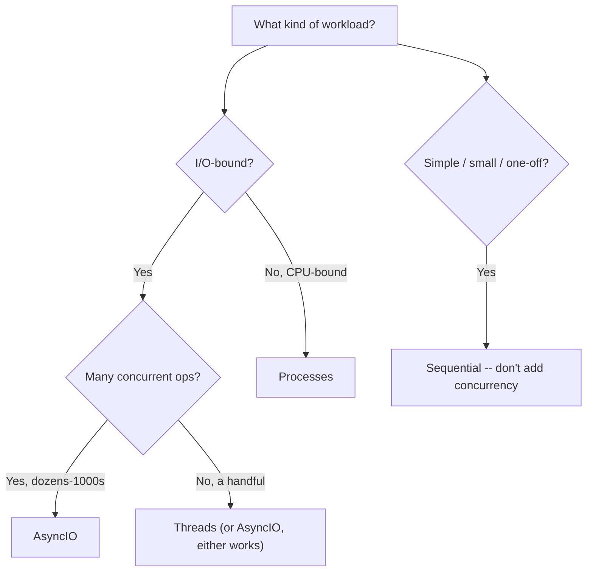

# Chapter 9 — Concurrency Decision Making

## Concept

You now have four tools from Chapters 6-8 (plus plain sequential code).
The engineering skill isn't knowing each one exists — it's picking the
right one FAST, for a given workload, without overthinking it.

```
                 +-- AsyncIO
Workload --------+-- Threads
                 +-- Processes
                 +-- Sequential
```

## The decision framework

```
Is the work I/O-bound (waiting on network/disk/timers)?
   |
   YES -> Many concurrent operations (dozens to thousands)?
   |         |
   |         YES -> AsyncIO (lowest overhead at high concurrency)
   |         NO  -> Threads are fine too (simpler if you have blocking
   |                 libraries that don't support async)
   |
   NO (it's CPU-bound: heavy computation, no waiting)
   |
   YES -> Processes (ProcessPoolExecutor / multiprocessing) --
   |       this is the ONLY option of the four that gives real speedup
   |       for CPU-bound work in CPython, because of the GIL.
   |
Is the workload simple / small / a one-off?
   -> Sequential. Concurrency has real overhead (thread/process
      creation, event loop setup, coordination complexity, harder
      debugging) -- don't pay that cost for a task that finishes in
      milliseconds anyway.
```

## Mental model

Don't reach for a power tool to hang one picture frame. Every concurrency
tool trades simplicity for speed under specific conditions. If those
conditions (I/O-bound + high volume, or CPU-bound + parallelizable) don't
hold, sequential code is not just "good enough" — it's usually the
CORRECT choice, because it's easier to read, debug, and reason about.

## Diagram



## Files

`decision_framework.py` — an executable version of the decision tree
above (`recommend_approach(...)`), plus 8 realistic scenarios you can
run through it to see the reasoning, framed as a self-check quiz: guess
first, then reveal.

## Run it

```bash
python3 decision_framework.py
```

## Real scenarios to reason through yourself (before running)

1. Downloading 500 product images from a CDN before generating a report.
2. Resizing 500 already-downloaded images to thumbnails.
3. A CLI tool that reads one config file and prints a summary.
4. A web scraper hitting 50 different news sites once each.
5. Computing SHA-256 hashes of 10,000 large video files on disk.
6. A chat server handling 5,000 simultaneous open WebSocket connections.
7. A script that calls one external API once, waits for the response,
   and exits.
8. Training/running inference for 8 independent ML model instances,
   each pinned to use one CPU core fully.

For each, decide: I/O-bound or CPU-bound? Roughly how many concurrent
units of work? Then run `decision_framework.py` and check your reasoning
against its output for the same scenarios (they're built in).

## Experiment

Add a NINTH scenario of your own (pick something from your actual job —
Sachin, this could be genuinely from the UKG DocGen four-repo pipeline:
e.g. "fetching document templates from 3 different microservices before
rendering a document") and extend `decision_framework.py`'s scenario list
with it — reasoning through a real case is worth more than any number of
toy examples.
